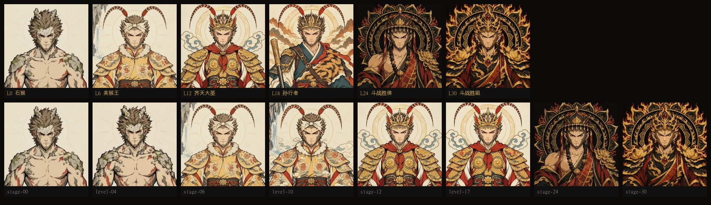

# Slide to Buddha · a DeepSeek Harness skin

[简体中文](README.md) | English

Drag a single intensity slider and watch Sun Wukong grow from a stone monkey into the Victorious Fighting Buddha. The UI palette, the light/dark theme and the portrait all move together —and the slider can drive the model's own reasoning effort, so changing a setting finally has a picture attached to it.



- **Six ranks**: Stone Monkey → Handsome Monkey King → Great Sage Equal to Heaven → Sun the Pilgrim → Victorious Fighting Buddha → Victorious Fighting Ancestor
- **31 portrait frames**, one for every level from 0 to 30 (15 and 27 are costume-change bridges between ranks)
- **Adaptive palette**: rice-paper white → ochre → peach gold → furnace fire → black and gold, all interpolated from one table
- **Leaves the host alone**: the switch lives inside the native *Settings → General → Appearance* row, and clicking any native theme button leaves the skin

## Install

### Option 1 (recommended): hand the prompt to DSH

No command line needed. **Copy the whole block below and paste it to DSH** — it checks for conflicts, installs, then verifies:

```text
Please install the "Slide to Buddha" skin into DSH's desktop profile. Check for
conflicts first and only install once you have confirmed it is safe.

1. Before installing, read the desktop profile's package.json (dependencies and
   dsh.profile.bundles), that profile's cordis.patch.yml and
   $DSH_HOME/cordis.patch.yml if present.
2. From the currently enabled bundles, identify any other skin, theme or
   appearance plugin. Exclude @deepseek-ai/dsh-base, @deepseek-ai/dsh-web-app,
   dsh-skin-market and the target itself
   @daily-vibe/dsh-client-wukong-intensity-skin. Inspect each candidate's
   package.json (name, description, dsh.client / dsh.bundle declarations) and
   read its README if needed.
3. If you find another enabled skin plugin, list it and stop before installing.
   Ask me to disable it first. Do not modify any profile file and do not install
   without my confirmation.
4. If there is no conflict, say "no other enabled skin plugins detected" and run:

   dsh plugin --profile desktop add 'github:JerryZ01/dsh-wukong-skin'

5. After installing, read the desktop profile's package.json and confirm both
   dependencies and dsh.profile.bundles contain
   @daily-vibe/dsh-client-wukong-intensity-skin. Then check the package's
   dsh.client / dsh.bundle declarations and the wukong-intensity-skin entry in
   cordis.patch.yml. Report a failure if anything is missing.
6. Tell me how to restart DSH. Do not install, disable or uninstall any other
   skin on my behalf.
```

Step 3 matters: if another skin is already enabled in your profile, it **stops and asks** instead of painting over your UI.

### Option 2: command line

```sh
dsh plugin --profile desktop add 'github:JerryZ01/dsh-wukong-skin'
```

Verify (the package name should appear in the output):

```sh
dsh plugin --profile desktop list
```

> **What is `desktop`?** A profile name — the directory name under `~/.dsh/profiles/`. The official Desktop uses `desktop`; `dsh web` uses `web`. Installing into the wrong one does not error, but the skin will not show up in the UI you are actually using. Run `ls ~/.dsh/profiles` if unsure.

> **"`dsh` is not recognized"?** The DSH CLI is not on your PATH. Call it by full path — the location depends on how DSH was installed:
>
> - Official Desktop: `"$env:LOCALAPPDATA\Programs\DeepSeek Harness\resources\runtime\cli\bin\dsh.cmd"`
> - Portable / custom directory: `"<install dir>\resources\runtime\cli\bin\dsh.cmd"`
>
> For example: `& "<install dir>\resources\runtime\cli\bin\dsh.cmd" plugin --profile desktop add 'github:JerryZ01/dsh-wukong-skin'`
>
> If you cannot find it, use Option 1 — hand the prompt to DSH and it will locate the command itself.

### Option 3: clone and install locally (for hacking on it)

The built bundle `lib/client.js` is committed, so a clone needs **no** `npm install` or `npm run build`:

```sh
git clone https://github.com/JerryZ01/dsh-wukong-skin.git
cd dsh-wukong-skin
dsh plugin --profile desktop add .
```

`add .` creates a **link dependency pointing at the clone**, so afterwards you can edit the source, run `npm run build`, restart DSH, and see your change without reinstalling. This is the path to take if you want to swap the portraits or the palette.

### After installing

**Quit DSH completely and reopen it** (including the tray icon — closing the window is not enough). `bundles` is read once at startup; without a restart the skin is not loaded.

`dsh plugin` appends the plugin to `dsh.profile.bundles` and loads the bundled `cordis.patch.yml` for you — **no manual config editing required**.

### Uninstall

```sh
dsh plugin --profile desktop remove @daily-vibe/dsh-client-wukong-intensity-skin
```

`remove` also drops it from `dsh.profile.bundles`; after a restart the settings entry is gone.

> **This skin is mutually exclusive with other skins.** It prepends a backdrop to `body`, overwrites a batch of `--dsw-alias-*` variables and calls `theme.setTheme()`. Running it alongside a similar skin makes the two paint over each other. Keep exactly one per profile.

## Usage

### The slider

A track appears at the right edge of the composer. It reads **the current model's own** `reasoning.efforts`; no step count or step name is hardcoded.

- Any N efforts spread evenly across 0–30: two steps give `0 / 30`, three give `0 / 15 / 30`, five give `0 / 7.5 / 15 / 22.5 / 30`.
- While dragging, the skin only previews. Nothing is committed.
- On pointer-up, keyboard completion or blur, it snaps to the nearest step and commits that step's original ID through the official `ModelDirectory`.
- Models without reasoning support, or with a single selectable step, show no slider. Addressed subagents show none either.

### The line

A line sits above the track and **changes once per rank**. Four lines cover six ranks:

| Rank | Line | Mood |
| --- | --- | --- |
| Stone Monkey | 俺老孙来也！ | announcing himself |
| Handsome Monkey King | 吃俺老孙一棒！ | about to strike |
| Great Sage Equal to Heaven | 吃俺老孙一棒！ | about to strike |
| Sun the Pilgrim | 妖怪，哪里跑！ | giving chase |
| Victorious Fighting Buddha | 妖怪，哪里跑！ | giving chase |
| Victorious Fighting Ancestor | 俺上天看看路径，日后好带你们上去同住。 | after taking the throne |

The middle two ranks share a line with the one before — four short lines are far easier to source real audio for than six.

> Earlier versions quoted the 100-chapter novel verbatim. Those lines were accurate on paper, but no actor ever recorded them, so they could not be matched to real audio. The set is now chosen by what actually exists on sound archives.

The line follows the thumb immediately — it does not wait for the commit — and fades to 35% while you drag so it does not compete with the step tooltip.

### Speaking it aloud

Turn on **Speak the line aloud** in settings and the skin reads the line when you cross into a new rank.

- It plays **four audio files** (`assets/voice/line-N.*`) served by the plugin's own static route.
- `wav` / `mp3` / `m4a` / `ogg` / `flac` all work; the host scans the directory and reports the real format to the client through `/voice/manifest.json`.
- Four lines cover six ranks: `[0, 1, 1, 2, 2, 3]`.
- All four are preloaded on mount, so changing rank is a replay with no network hop.
- Crossing into a new rank stops the previous clip, otherwise two lines talk over each other.
- Turning the switch off silences immediately rather than letting the clip finish.
- Off by **default** — the page never starts talking on its own.
- No network, no speech API, no text ever leaves the machine.
- **The repository ships all four clips** (`assets/voice/line-0..3.wav`, 318 KB total), so it works out of the box.

**Why not `speechSynthesis`**: it was tried. In Electron the autoplay policy silently rejects it (`error: not-allowed`), the first synchronous `getVoices()` call returns an empty array, and voices differ wildly between machines. Pre-recorded files can be **verified on the spot** — decoded and played back in a real Chromium, with `currentTime` confirmed to advance.

To import:

```sh
npm run voices
```

The script converts each clip to 16 kHz mono, checks that it is not silent, and writes it to `assets/voice/`. Clips go in `.cache/raw-voice/`; name them with a `line-0`…`line-3` number, or let the script match them by keywords.

Changing a line means editing three places: `LINES` in `src/client/logic.js`, the `LINES` table at the top of `tools/import-voice.mjs`, and the four strings pinned in `tools/test-logic.mjs`.

### The appearance row

Everything lives in **Settings → General → Appearance**:

| Control | Effect |
| --- | --- |
| `婊戝姩鍙樹經` (Wukong) | Shows the slider and turns on the portrait, backdrop and adaptive palette |
| Native `Light` / `Dark` / `Follow system` | Removes the backdrop, the skin variables and the slider; returns to that native appearance |
| `滑动变佛绑定思考等级` (bind effort) | When off, the slider only changes the look and leaves the model's reasoning effort alone |

The bind flag is stored in browser localStorage (`dsh-wukong-intensity-skin.bind-effort`).

### Light and dark

Past level 24 the palette turns black and gold, and the skin sets the host theme to dark; dropping back below it restores light. That is deliberate, not a side effect —otherwise every native control would sit on the black-gold backdrop as a pale patch.

## Portraits

31 half-body illustrations (1024×1024, WebP, about 9 MB), generated frame by frame. No recoloured source art and no placeholders. The six ranks form one reference chain — each rank first gets a defining frame, and the next rank uses the previous rank's finished frame as its image-to-image reference — so dragging from end to end shows one face growing up, not 31 different monkeys. Decoration ceilings rise rank by rank and are never allowed to invert, or later levels would look plainer than earlier ones.

To use your own art: prepare 31 images at 1024×1024 whose names match the files in `assets/portrait/`, then overwrite them in place. No code change, no rebuild.

For regeneration, the frame table, and how the prompts keep the style from drifting, see [`assets/portrait/SOURCES.md`](assets/portrait/SOURCES.md).

## Build

```sh
npm install
npm run build
```

`npm run build` bundles `src/client/index.jsx` into `lib/client.js` with esbuild (CJS wrapped in `window.__ModuleLoader__.load`), with the CSS inlined as text. **Commit `lib/client.js` along with your source changes** —without it the installed plugin has no browser half. CI fails if the committed bundle is stale.

## Tests

Six offline suites, none of which needs a running DSH:

```sh
npm test                # runs the five below

npm run check           # frame tables agree: client PORTRAIT_ANCHORS ↔ host FRAMES ↔ files on disk
npm run test:unit       # pure functions, asset routes, Range/ETag/304/416, and the voice player
npm run test:dom        # browser half: style injection, backdrop, appearance button, full teardown
npm run test:render     # React half: drag preview, commit on release, bind switch, which clip plays
```

Everything runs after `npm install`; `jsdom`, `react` and `react-dom` are devDependencies. If your machine keeps them outside the checkout, override with `JSDOM_PATH` / `REACT_PATH`.

The fifth suite, `test:compose`, runs the **real runtime's** `loadProfileDirectory()` and therefore needs DSH itself:

```powershell
$env:ELECTRON_RUN_AS_NODE = '1'
$env:DSH_RUNTIME_MODULES  = 'file:///<install dir>/resources/app.asar/dsh/node_modules'
& '<install dir>\DeepSeek Harness.exe' tools/test-compose.mjs
```

It assembles a throwaway profile in a temp directory to verify patch-layer order and final row order, and never touches your own profile.

## Troubleshooting

**Installed, but there is no "Slide to Buddha" in Settings.**

In order:

1. **Did you restart?** Quit DSH fully (tray icon included). `bundles` is read once at startup.
2. **Right profile?** `dsh plugin --profile desktop list` shows the package, but the UI you are looking at may be served by a different profile.
3. **Is it in `bundles`?** Being in `dependencies` does not enable anything. Open `~/.dsh/profiles/desktop/package.json` and confirm `dsh.profile.bundles` contains `@daily-vibe/dsh-client-wukong-intensity-skin`.
4. **Is another skin enabled?** Similar skins overwrite the backdrop and theme variables, so keep one per profile.

**The settings entry is there, but no slider appears.**

The slider only shows for models that **support reasoning and expose at least two steps**. With a model that has no reasoning options it stays hidden — that is correct behaviour, not a broken install.

**The palette changed and my light/dark theme got switched.**

By design. Past level 24 (Victorious Fighting Buddha) the palette turns black and gold and the skin sets the host theme to dark; dropping back below restores light. Otherwise every native control would sit on the black-gold backdrop as a pale patch.

**Hard edges or a dark fringe around the portrait.**

The backdrop colour is computed by `paletteForFrame()` and baked into the art so the two always match. If you swapped in your own images without updating the palette, the seam shows — see "Use your own art".

**Can I run two skins at once?**

No. Both prepend a backdrop, overwrite the same `--dsw-alias-*` variables and call `theme.setTheme()`, so they paint over each other. Keep one at a time.

## Known limitations

- The five frames inside a rank show one character at increasing intensity, not five different poses: dragging through a rank shows pattern density changing, not motion. That is the price of monotonicity.
- Chained image-to-image drifts slightly, more so at later levels. Redraw any single frame with `npm run portraits -- --only <frame>`.
- The skin changes the host's light/dark theme and intercepts clicks on the native appearance buttons. Both are intentional.
- Native appearance choices are not remembered across reloads: returning to a native theme only lasts for the current client activation.
- Running alongside a similar skin conflicts; keep one per profile.
- Portraits are AI-generated and included for demonstration —see Licensing below.

## Licensing

Code is released under the [MIT License](LICENSE).

The 31 portraits under `assets/portrait/` are **stylised character illustrations** generated with `gpt-image-2.5`. They are not based on any real person's likeness or any third-party artwork, and ship under the same MIT terms. For commercial distribution, prefer regenerating them with `npm run portraits` so that upstream model output terms do not get tangled in.

*Journey to the West* and Sun Wukong are public-domain material. This project is an independent implementation.

## Copyright and assets

**The MIT licence above covers the code. It does not cover the four recordings in `assets/voice/`.**

| | |
| --- | --- |
| Source | The 1986 CCTV television adaptation of *Journey to the West* |
| Copyright | China Central Television |
| Performers' rights | Li Shihong (first five episodes), Li Yang (the rest) |
| Status | Unlicensed, shipped with the repository |

These four clips are dialogue lifted straight from the show — not re-recorded, not synthesised. Including them in an MIT repository is a **deliberate exception**: the licence covers the code I wrote, not somebody else's performance.

If you intend to use this commercially, redistribute it, or host it publicly, **obtain permission or replace the clips with material you have the rights to**. To swap them:

```sh
# 1. put audio in .cache/raw-voice/, named line-0 ~ line-3
# 2. import (converts to 16 kHz mono, verifies it is not silent)
npm run voices
# 3. verify it actually makes sound
node tools/probe-voice.mjs
```

Removing the four files does not break anything — speech simply goes silent while the rest of the UI keeps working.
